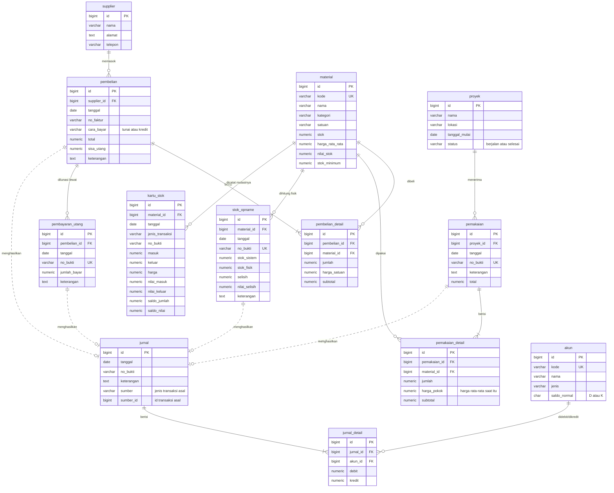

# SIPERKON — Sistem Persediaan untuk Perusahaan Konstruksi

Aplikasi web untuk mencatat persediaan material perusahaan kontraktor: pembelian dari supplier, pemakaian material ke beberapa proyek yang berjalan bersamaan, stok opname, sampai **jurnal akuntansi yang dibuat otomatis** oleh database.

- **Metode pencatatan:** perpetual (stok & nilai persediaan diperbarui setiap transaksi)
- **Metode penilaian:** rata-rata bergerak (*moving average*)

> Tugas UTS Pengkodean dan Pemrograman — S1 Akuntansi

**🔗 Web demo:** https://enostandirapak2006-blip.github.io/sistem-persediaan-konstruksi/

*(Demo memakai database contoh bersama — data yang kamu tambahkan bisa dilihat pengunjung lain.)*

| | |
|---|---|
| Nama | Enos Inzaghi Tandirapak |
| NIM | 12030124140335 |
| Kelas | E |

---

## Teknologi

| Bagian | Teknologi |
|---|---|
| Frontend | HTML, CSS, JavaScript biasa (tanpa framework), satu `index.html` dengan menu single-page |
| Backend | [Supabase](https://supabase.com) (PostgreSQL): tabel, trigger, fungsi RPC, Row Level Security |
| Koneksi | [supabase-js v2](https://github.com/supabase/supabase-js) lewat CDN |
| Font | IBM Plex Sans (Google Fonts) |

---

## Fitur

**Data master**
- **Material** — kode, nama, kategori, satuan, stok minimum. Stok, harga rata-rata, dan nilai stok terisi otomatis dari transaksi.
- **Supplier** — beserta total sisa utang ke masing-masing supplier.
- **Proyek** — status *berjalan* / *selesai*; proyek selesai tidak bisa menerima material.

**Transaksi** (tersimpan utuh atau gagal seluruhnya; tidak bisa diedit/dihapus)
- **Pembelian** tunai/kredit dengan banyak baris material.
- **Pembayaran Utang** — ditolak jika melebihi sisa utang; sisa utang berkurang otomatis.
- **Pemakaian Material** ke proyek — ditolak jika melebihi stok; dinilai dengan harga rata-rata saat itu.
- **Stok Opname** — stok sistem disamakan dengan hasil hitung fisik, selisihnya dijurnal.

**Laporan**
- **Dashboard** — total nilai persediaan, total utang usaha, proyek berjalan, saldo kas, peringatan stok di bawah minimum, transaksi terakhir.
- **Kartu Stok** — mutasi per material, filter rentang tanggal, saldo awal & saldo berjalan (jumlah dan nilai).
- **Jurnal Umum** — format buku jurnal dengan cek keseimbangan debit-kredit.
- **Buku Besar** — per akun dengan saldo berjalan, ditambah Neraca Saldo.
- **Laporan Persediaan** — jumlah & nilai per material, **rekonsiliasi dengan saldo akun Persediaan di Buku Besar**, dan rekap pemakaian per proyek.

**Kenyamanan pengguna**
- Format Rupiah (`Rp 1.250.000`) dan tanggal Indonesia (`2 September 2026`).
- Pintasan keyboard di form transaksi: `Enter` = baris berikutnya, `Ctrl+Enter` = simpan.
- Tombol cetak dengan tampilan khusus cetak.

---

## Logika Akuntansi

Setiap transaksi menghasilkan **tepat satu jurnal** yang selalu seimbang (total debit = total kredit).

| Transaksi | Debit | Kredit |
|---|---|---|
| Saldo awal (setoran modal) | Kas | Modal |
| Pembelian tunai | Persediaan Material | Kas |
| Pembelian kredit | Persediaan Material | Utang Usaha |
| Pembayaran utang | Utang Usaha | Kas |
| Pemakaian material ke proyek | Biaya Material Proyek | Persediaan Material |
| Stok opname — fisik **lebih kecil** dari sistem | Beban Selisih Persediaan | Persediaan Material |
| Stok opname — fisik **lebih besar** dari sistem | Persediaan Material | Pendapatan Lain-lain |

**Daftar akun**

| Kode | Nama Akun | Jenis | Saldo Normal |
|---|---|---|---|
| 1101 | Kas | Aset | Debit |
| 1301 | Persediaan Material | Aset | Debit |
| 2101 | Utang Usaha | Liabilitas | Kredit |
| 3101 | Modal | Ekuitas | Kredit |
| 4201 | Pendapatan Lain-lain | Pendapatan | Kredit |
| 5101 | Biaya Material Proyek | Beban | Debit |
| 5201 | Beban Selisih Persediaan | Beban | Debit |

**Rumus rata-rata bergerak** (dihitung ulang setiap pembelian):

```
harga rata-rata baru = (nilai stok lama + nilai pembelian) / (jumlah stok lama + jumlah beli)
```

Contoh dari data seed — semen:
stok 120 sak senilai Rp 7.800.000 + beli 200 sak × Rp 67.000 = Rp 13.400.000
→ (7.800.000 + 13.400.000) / (120 + 200) = **Rp 66.250 per sak**.

---

## ERD (Entity Relationship Diagram)

Garis **putus-putus** menunjukkan hubungan lewat kolom `jurnal.sumber` + `jurnal.sumber_id` (bukan foreign key), yaitu transaksi mana yang menghasilkan sebuah jurnal.



**Catatan desain database**
- `material.nilai_stok` disimpan langsung (tidak dihitung dari stok × harga rata-rata) supaya tidak ada selisih pembulatan, sehingga total Laporan Persediaan **selalu sama persis** dengan saldo akun Persediaan Material.
- `kartu_stok` hanya diisi oleh trigger, tidak pernah dari aplikasi.
- Transaksi sebuah material tidak boleh bertanggal lebih awal dari transaksi terakhirnya, karena rata-rata bergerak dihitung berurutan.

---

## Cara Kerja Penyimpanan Transaksi

Satu transaksi pembelian = header + beberapa detail + perubahan stok + kartu stok + jurnal. Semuanya harus tersimpan **sekaligus atau gagal seluruhnya**.

Caranya: frontend memanggil **satu fungsi database** lewat `supabase.rpc()`:

```js
await db.rpc('simpan_pembelian', {
  p_supplier_id: 1,
  p_tanggal: '2026-10-10',
  p_no_faktur: 'INV-0012',
  p_cara_bayar: 'kredit',
  p_keterangan: null,
  p_items: [{ material_id: 1, jumlah: 100, harga_satuan: 65000 }]
});
```

Di PostgreSQL, satu pemanggilan fungsi berjalan dalam **satu transaksi**. Jika ada satu saja error (misalnya stok kurang di baris ke-3), **semua perubahan dibatalkan otomatis** (rollback). Ini cara paling sederhana untuk pemula karena tidak perlu mengatur transaksi di JavaScript.

Pembagian tugasnya:

| Bagian | Tugas |
|---|---|
| **Trigger** (`triggers.sql`) | Efek per baris detail: tambah/kurangi stok, hitung harga rata-rata, isi kartu stok, kurangi sisa utang, validasi |
| **Fungsi RPC** `simpan_*` | Membungkus satu transaksi utuh, lalu membuat **satu** jurnal setelah semua detail masuk |

Jurnal sengaja tidak dibuat di trigger detail, karena trigger berjalan sekali per baris — faktur berisi 3 material akan menghasilkan 3 jurnal.

Fungsi RPC yang tersedia: `simpan_pembelian`, `simpan_pemakaian`, `simpan_pembayaran_utang`, `simpan_stok_opname`.

---

## Keamanan (Row Level Security)

Frontend hanya memakai **publishable / anon key**. Kunci ini memang boleh terlihat publik, karena database membatasi apa yang boleh dilakukan pemiliknya:

| Data | Yang diizinkan untuk anon key |
|---|---|
| Semua tabel & view | Hanya **baca** |
| Supplier, Proyek | Tambah & ubah |
| Material | Tambah & ubah, **kecuali** kolom `stok`, `harga_rata_rata`, `nilai_stok` |
| Tabel transaksi & jurnal | Tidak bisa ditulis langsung — hanya lewat 4 fungsi `simpan_*` (`security definer`) |
| Ubah / hapus transaksi | Ditolak (tidak ada policy UPDATE/DELETE + trigger pengunci) |
| Fungsi internal (`buat_jurnal`, dll.) | Tidak bisa dipanggil |

> **Jangan pernah** menaruh `service_role` / secret key di kode. Kunci itu melewati semua RLS.

---

## Struktur Folder

```
sistem-persediaan-konstruksi/
├── backend/
│   ├── schema.sql      # 13 tabel, relasi, view laporan, RLS & hak akses
│   ├── triggers.sql    # trigger stok/kartu stok/utang + fungsi RPC simpan_*
│   └── seed.sql        # akun, modal awal, material, supplier, proyek, transaksi contoh
├── frontend/
│   ├── html/
│   │   └── index.html  # satu-satunya halaman (sidebar + wadah konten)
│   ├── css/
│   │   └── style.css
│   └── js/
│       ├── supabase.js # koneksi (URL + publishable key)
│       ├── utils.js    # format Rupiah & tanggal, pesan error, dll.
│       ├── app.js      # pindah menu (single-page)
│       └── ...         # satu file per menu (dashboard.js, pembelian.js, dst.)
├── index.html          # pengalih untuk GitHub Pages -> frontend/html/index.html
├── .gitignore
└── README.md
```

---

## Cara Menjalankan

### 1. Siapkan database di Supabase
1. Buat project baru di [supabase.com](https://supabase.com).
2. Buka **SQL Editor → New query**, lalu jalankan isi file berikut **berurutan**:
   1. `backend/schema.sql`
   2. `backend/triggers.sql`
   3. `backend/seed.sql`
3. Cek hasilnya:
   ```sql
   select kode, nama, saldo from v_saldo_akun order by kode;
   ```
   Hasil yang benar: Kas 438.000.000 · Persediaan Material 44.685.500 · Utang Usaha 34.350.000 · Modal 500.000.000.

> Untuk mengulang dari nol, jalankan lagi ketiga file dengan urutan yang sama (`schema.sql` menghapus semua data lama).

### 2. Sambungkan frontend
Buka `frontend/js/supabase.js`, isi dengan data dari **Project Settings → API Keys**:

```js
const SUPABASE_URL = 'https://<project-id>.supabase.co';
const SUPABASE_ANON_KEY = '<publishable / anon key>';
```

### 3. Jalankan
1. Buka folder proyek di VS Code.
2. Pasang ekstensi **Live Server**.
3. Klik kanan `frontend/html/index.html` → **Open with Live Server**.

---

## Pengujian

| Skenario | Hasil yang diharapkan |
|---|---|
| Buka Dashboard | Banner "4 material di bawah stok minimum" |
| Laporan Persediaan | Kotak rekonsiliasi hijau: total persediaan = saldo akun 1301 |
| Pemakaian Besi D13 sebanyak 100 (stok 60) | Ditolak: *Stok "Besi Beton Ulir D13" tidak cukup* |
| Bayar utang melebihi sisa | Ditolak: *Pembayaran ... melebihi sisa utang* |
| Pemakaian ke proyek berstatus selesai | Ditolak |
| Jurnal Umum & Neraca Saldo | Badge "Seimbang" |
| `select * from v_cek_keseimbangan_jurnal where not seimbang;` | 0 baris |
